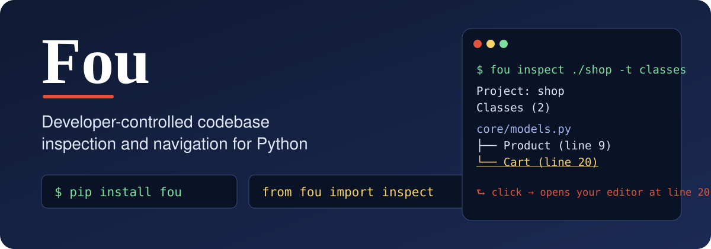
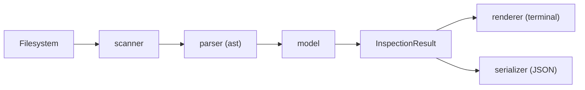

<p align="center">
  
</p>

<p align="center">
  <a href="https://github.com/mohammadmehdimasoumi/fou/actions/workflows/ci.yml"></a>
  <a href="https://pypi.org/project/fou/"></a>
  
  
  
  <a href="LICENSE"></a>
</p>

**Fou** answers one question with one function call:

> *What exists inside this project, and what is its structure?*

It reads your source with Python's own `ast` and `tokenize` modules and returns
structured, predictable results you can **print, iterate over, save as JSON, or click**.

```python
from fou import inspect

project = inspect("./my_project")
print(project.classes(details=True))
```

<p align="center">
  <br>
  <sub>90-second tour · <a href="docs/demo.mp4">watch in full quality (MP4)</a></sub>
</p>

Fou is a **deterministic library and CLI, not an AI agent**: no model decides what is
relevant, nothing is sent anywhere, and your code is never run or modified.

---

## Why Fou?

IDEs are powerful but live inside a window and are hard to script. Linters and doc
generators are scriptable but built for a single purpose. Fou sits in the gap: a small
library whose whole job is to *describe a project's structure* and let **you** decide
what to do with that description.

| Fou is | Fou is not |
|---|---|
| a deterministic library and CLI | an AI agent |
| a reader of source code (static) | something that runs or imports your code |
| offline, standard-library only | something that uses the network |

### Six promises

| | |
|---|---|
| **Deterministic** | Same project + same arguments = byte-identical output, even across machines. |
| **Developer-controlled** | You choose directory, depth, extensions, exclusions and types. |
| **Zero dependencies** | Only the Python standard library. |
| **Two interfaces, one engine** | Python API or the `fou` command – same code path. |
| **Robust** | A syntax error in one file is *recorded*; everything else is still inspected. |
| **Navigable** | Terminal hyperlinks open your editor at the exact line you clicked. |

---

## Install

```bash
pip install fou
```

Or from source:

```bash
git clone https://github.com/mohammadmehdimasoumi/fou.git
cd fou
pip install -e ".[dev]"
pytest
```

Requires Python 3.9+. Check it worked:

```bash
fou --version
python -m fou --version
```

---

## 60-second tour

The repo ships a tiny tutorial project, [`examples/shop`](examples/shop), that contains
every construct Fou understands. All output below is real.

### The file tree, with honest line counts

```console
$ fou inspect examples/shop
Project: shop

├── __init__.py
│   -> 1 line
│
├── config.py
│   -> 4 lines
│
├── main.py
│   -> 7 lines
│
├── core/
│   ├── __init__.py
│   │   -> 0 lines
│   │
│   ├── models.py
│   │   -> 20 lines
│   │
│   └── payment.py
│       -> 7 lines
│
└── utils/
    └── helpers.py
        -> 8 lines
```

`-> 20 lines` means **20 lines of actual code** – blanks, comment-only lines and
docstrings are not counted (`core/models.py` is 35 physical lines).

### Classes and their methods (`-t classes -d`)

```console
$ fou inspect examples/shop -t classes -d
Project: shop

Classes (2)

core/models.py
├── Product  (line 9)
│   -> 6 lines
│   -> decorators: @dataclass
│   -> doc: A product that can be sold.
│   └── with_tax(self) -> float  (line 15)
│       -> 2 lines
│       -> doc: Return the price including tax.
└── Cart  (line 20)
    -> 11 lines
    -> doc: A shopping cart.
    ├── __init__(self) -> None  (line 23)
    │   -> 2 lines
    ├── add(self, product: Product) -> None  (line 26)
    │   -> 2 lines
    ├── total(self) -> float  (line 30)
    │   -> 3 lines
    │   -> decorators: @property
    │   -> property method
    └── empty_message() -> str  (line 34)
        -> 3 lines
        -> decorators: @staticmethod
        -> static method
```

### The same thing from Python

```python
from fou import inspect

project = inspect("examples/shop")      # instant – nothing is scanned yet
result = project.classes()              # the first query scans & parses, once

len(result)                             # 2
for cls in result:
    print(cls.qualname, "->", cls.path, "line", cls.location.lineno)
# Product -> core/models.py line 9
# Cart -> core/models.py line 20
```

Methods **return** result objects – nothing is printed unless you print it, so Fou is
safe inside programs, tests and web services.

---

## Click a class, land on its line

Every file name and every element in the terminal output can be a hyperlink
([OSC 8](https://gist.github.com/egmontkob/eb114294efbcd5adb1944c9f3cb5feda)) that opens
the file **at that exact line** in your editor:

```bash
fou inspect . -t methods --editor vscode
export FOU_LINK_SCHEME=vscode          # make it the default
```

```python
project.classes().show(scheme="vscode")                 # links on a terminal, plain in a pipe
project.classes().show(links="always", scheme="pycharm")
```

Built-in schemes: `file`, `vscode`, `vscode-insiders`, `cursor`, `pycharm`, `idea`,
`sublime`, `textmate` – or your own template such as
`"myeditor://open?file={fspath}&line={line}"`. Pipes, files and JSON never contain
links, so CI output stays clean.

Works in iTerm2, Windows Terminal, the VS Code terminal, GNOME Terminal, kitty,
WezTerm, Alacritty and foot. (macOS Terminal.app has no OSC 8 support; inside tmux you
need 3.4+.)

---

## Nine inspection types

| type | method | what it lists |
|---|---|---|
| `files` | `project.files()` | the project tree, with code-line counts |
| `imports` | `project.imports()` | one entry per imported name (internal vs external) |
| `functions` | `project.functions()` | `def` outside class bodies, nested included |
| `async_functions` | `project.async_functions()` | `async def` outside class bodies |
| `classes` | `project.classes()` | `class` statements, nested included |
| `methods` | `project.methods()` | `def` / `async def` directly in a class |
| `variables` | `project.variables()` | bindings with a scope: module, class, instance, local |
| `constants` | `project.constants()` | `UPPER_CASE` or `Final` names |
| `decorators` | `project.decorators()` | each decorator, linked to its target |

Combine them: `project.query(type=["classes", "constants"], details=True)` or
`fou inspect . -t classes,constants -d`. Pass `"all"` for everything.

`details=True` never changes *which* elements you get – it only adds fields: signatures,
parameters, return types, docstrings, decorators, bases, code-line counts, import
flags (`internal`, `conditional`, `type_checking`) and more.

---

## JSON for tools, CI and diffs

```python
result = project.query(type=["classes", "methods"], details=True)
result.save(format="json", path="./structure.json")     # atomic write
```

```bash
fou inspect . -t all --json -o structure.json
fou inspect . --links never --json | python -m json.tool
```

The document has a stable, versioned layout (`schema_version: "1.0"`) and elements
refer to each other through stable ids such as `core/models.py::Cart.total`. Because the
output is deterministic you can commit it and compare two versions with a plain `diff`.

---

## Recipes

Plain Python on top of Fou results – full runnable versions in [`examples/`](examples):

```python
# Which third-party packages does my project import?
external = Counter()
for imp in project.imports(details=True):
    if not imp.attrs.get("internal"):
        external[(imp.attrs.get("module") or imp.name).split(".")[0]] += 1

# Fail CI when a function is too long
too_long = [el for el in project.query(type=["functions", "methods"], details=True)
            if el.details["code_lines"] > 40]

# Health check: does all my Python even parse?
assert not project.classes().errors
```

More in the notebook: docstring audits, per-file summaries, CSV export, Markdown API
index, and "what changed between two versions" using stable ids.

---

## Errors: loud for mistakes, quiet for messy projects

* **Your arguments are wrong** → a precise exception, immediately
  (`LocationError`, `InvalidDepthError`, `InvalidInspectionTypeError`, …). Everything
  derives from `FouError`.
* **The inspected project is messy** (unreadable folder, syntax error, bad encoding) →
  the problem is *recorded* in `result.errors` and the scan keeps going. One broken file
  never hides the other four hundred.

---

## How it works



Cheap work (validation) is eager; expensive work (scan, parse, line counting) happens on
demand, **once**. Call `project.refresh()` after files change.

```
fou.cli          argument parsing and exit codes – calls the library, nothing more
fou.inspection   options · scanner · reader · linecount · parser · analysis ·
                 inspector · result · renderer · serializer · links
fou.core         Location · Element / FileModel / ProjectModel · Result · errors
```

---

## Documentation

* 📒 **[Fou-Notebook.pdf](docs/Fou-Notebook.pdf)** – the complete 61-page illustrated
  tutorial: from the first command to JSON pipelines, clickable output and publishing.
* 📖 **[docs/REFERENCE.md](docs/REFERENCE.md)** – every argument, convention and rule.
* 🧪 **[examples/](examples)** – runnable scripts + the `shop` tutorial project.

## Limitations

Static analysis only: names created by `setattr`, `exec`, class factories or decorator
magic are invisible. Only `.py` files are analyzed (not `.pyi` stubs or notebooks).
Source must parse with the Python running Fou.

## Roadmap

`inspect` is the first module of Fou. Planned: **`find`**, **`locate`**, **`run`**,
**`relation`** – all built on the same project model in `fou.core`.

## Contributing

Issues and pull requests are welcome. Run `pytest` before opening a PR and keep Fou's
contract: deterministic ordering, no printing from library methods, dedicated
exceptions for bad arguments, and recorded (not raised) errors for problems in the
project being inspected.

## License

[MIT](LICENSE) © Mohammad Mehdi Masoumi · [github.com/mohammadmehdimasoumi](https://github.com/mohammadmehdimasoumi)
